# Лаба 9
# Первый коммит
### 1. Определение ветки
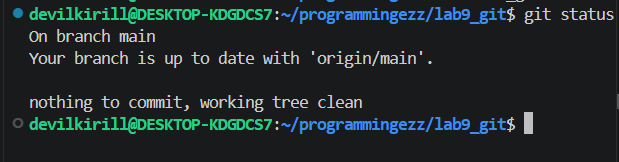

Вывело что нахожусь на ветке main и директория чиста

### 2. Журнал коммитов
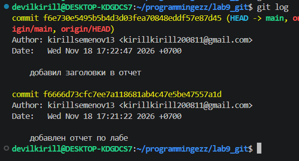

Выводит нашу историю создания коммитов

### 3. Создание файла sort.c
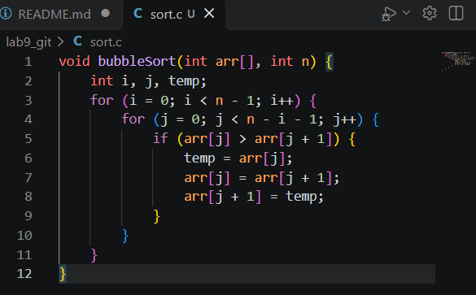

Создал файл sort.c и добавил туда функцию сортировки

### 4. Проверка статуса

сейчас он выглядит так

### 5-6. Добавление файла в stage и проверка статуса
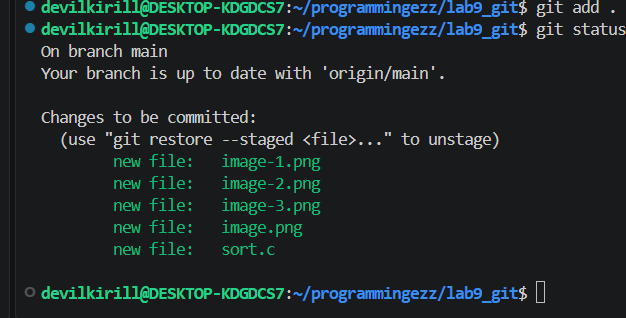

после добавления выглядит так

### 7-8. Первый коммит файла

закоммитил файл 

В результате ничего не осталось

### 9-12. Комментирование и добавление add

появился красным цветом, потому что изменили

после добавления стал зеленым, файл перешел в stage

### 13-15. Изменяем файл еще раз и смотрим статус
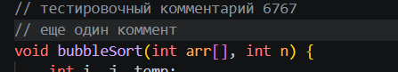

добавил коммент

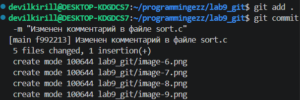

закоммитил 

а здесь статус чист, а в логе добавился последний 

### 16-17. Добавим в stage, и пушим
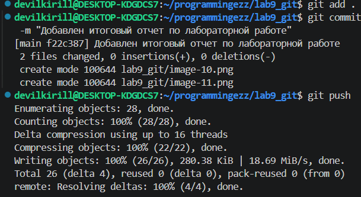

добавил и закоммитил, а после запушил

# Ветки
### 1-2. Создаем и смотрим новую ветку

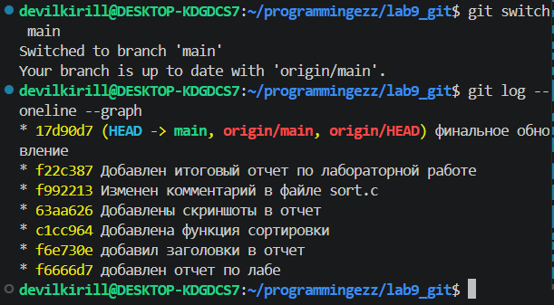

### 3. Переключаемся на новую ветку
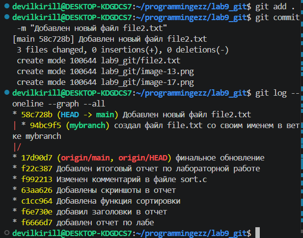

переключились

### 4-5. Статус при переключении

видим, что в первой строке появилось "on branch mybranch", строка означает что мы находимся на ветке mybranch, значит мы в этом убедились. 

### 6-8. Создаем файл с именем, коммитим, смотрим что ветка указывает на коммит

создал файл со своим именем, закоммитил, и убедился что ветка указывает на новый коммит

### 9-10. Возврат к main и проверка

мы видим, что коммит с file.txt пропал, потому что он есть только в той ветке mybranch

### 11-12. Новый файл и просмотр что будет

создал новый файл и увидел, что у двух веток разные коммиты!

### 13-15. Идем в mybranch, где file2.txt? Смотрим разницу

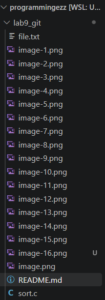

как видим, file2.txt пропал, так как он находится только в ветке main

с помощью команды git diff мы увидели, что в ветке main есть file2.txt, а в ветке mybranch есть file.txt

### 16-17. Добавляем в mybranch, убеждаемся что две ветки
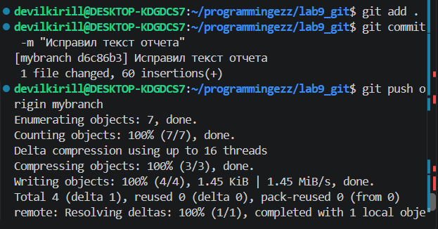

сначала не показывало текст лабы, пришлось исправить и сохранять второй раз, но все получилось!

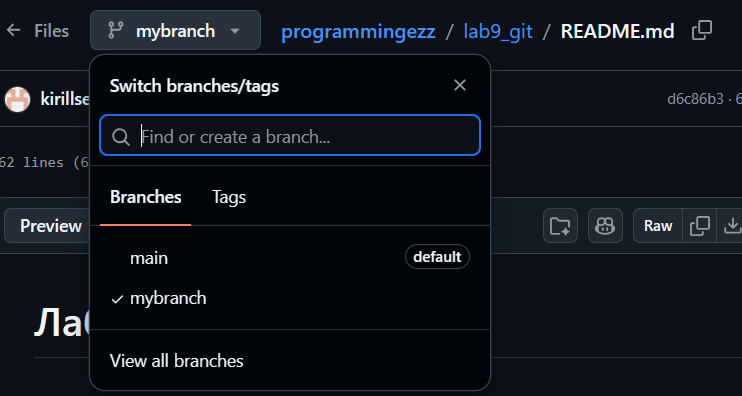
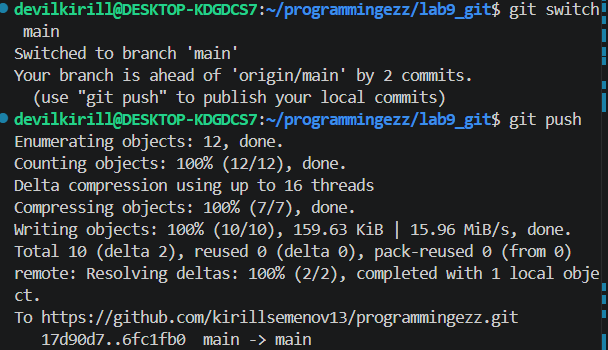

как видим, 2 ветки есть и запушил изменения в main

# Оценка 4

### Задания 1-4
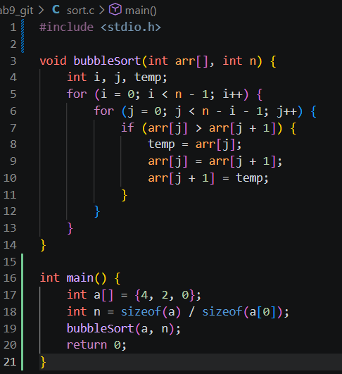
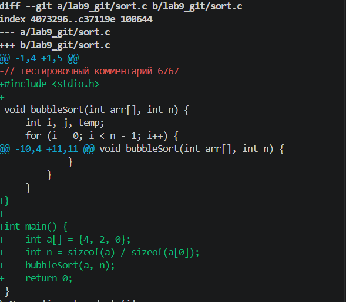

Перезаписав файл, diff нам показывает изменения в рабочей директории, которые еще не добавлены в stage

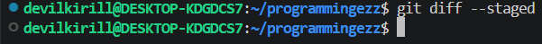

Пусто, потому что в stage сейчас ничего нет

### Задания 5-7
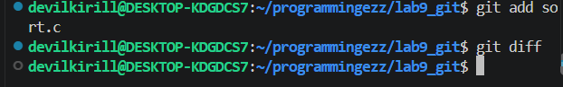

git diff ничего не говорит, так как все ушло в stage

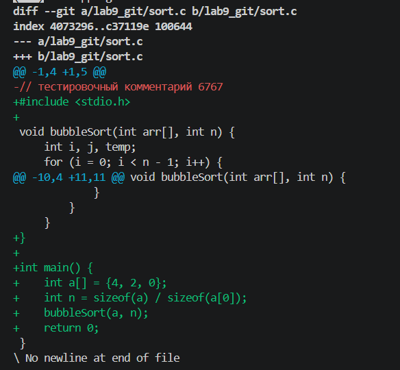

а вот сейчас он уже не пустой, так как смотрит в stage
### Задание 8-10
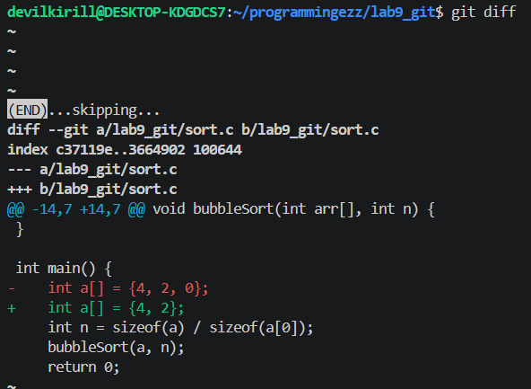

git diff показывает что было удалено

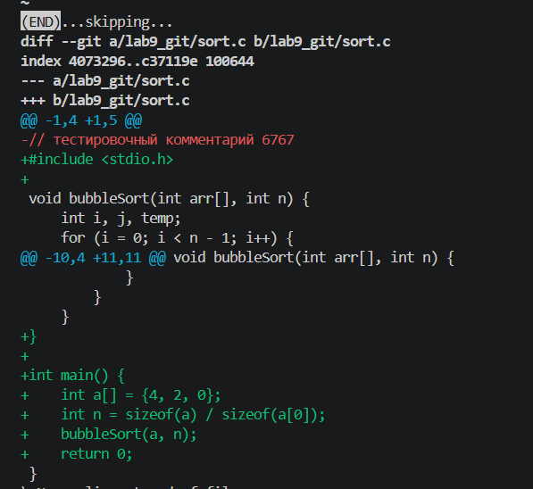

а вот git diff --staged показывает старый вариант где все еще есть 0

### Задание 11-12
Теперь у sort.c две версии, где в рабочей директории он без нуля, а в stage он с нулем

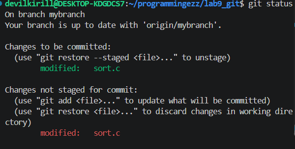

как мы видим, sort.c появляется 2 раза
### Задание 13-14
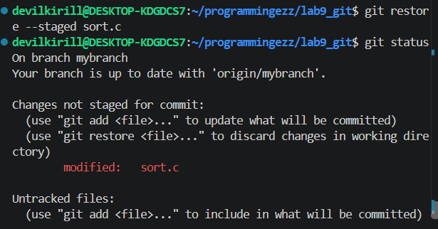

теперь файл показывается только один раз, так как файл вышел из stage
### Задание 15-16
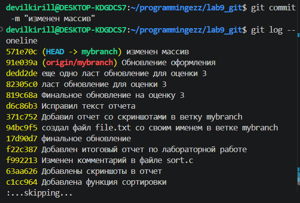
журнал на данном этапе выглядит так
### Задание 17-19
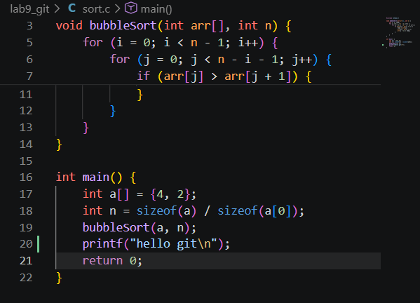

теперь в sort.c есть printf

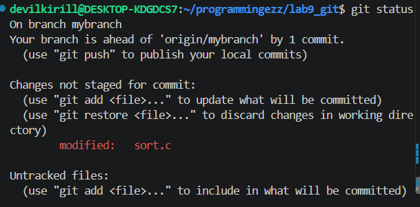

sort.c стал красным, потому что мы его изменили
### Задание 20-22
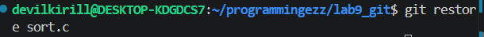
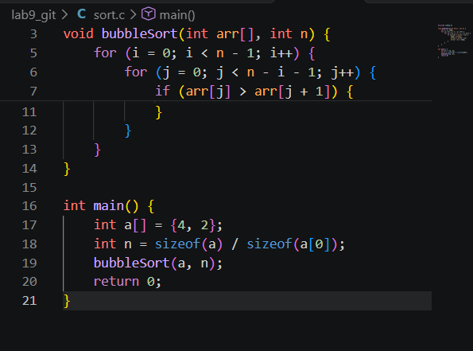

строчка с printf исчезла! мы откатились к последнему коммиту!

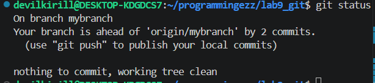

status ничего не покажет, потому что мы откатились к прошлой версии
### Задание 22
запушил на удаленный репо ветку

# Ветки и ff merge
### задания 1-2
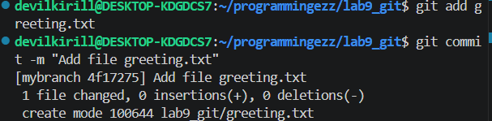
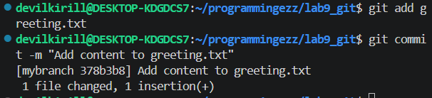

создал файл, проиндексировал и закоммитил его, а потом написал в нем слово hello и повторил прошлые действия

### Задания 3-5
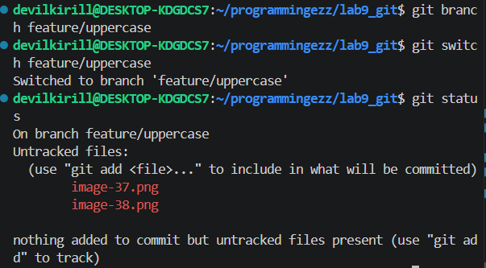

создал новую ветку и в status появилась наша новая ветка
### Задания 6-9
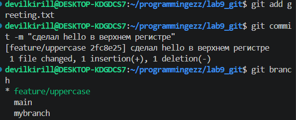

branch нам показал что мы сейчас на ветке future/uppercase

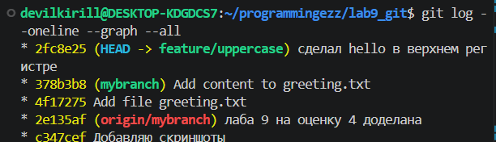

здесь мы увидели что новый коммит находится на новой ветке future, а ветка mybranch осталась на предыдущем коммите, ветки разошлись
### Задания 10-14
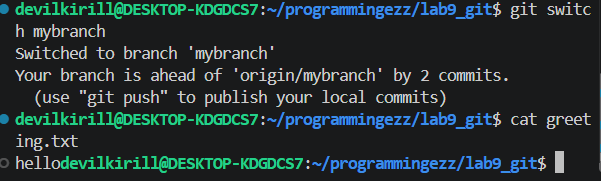

изначально я был на ветке mybranch и там же создал файл со словом hello, а так терминал вывел hello маленькими буквами

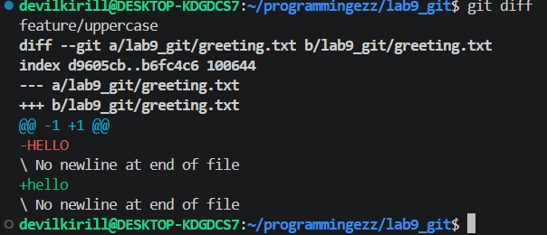

нам вывело разницу слов

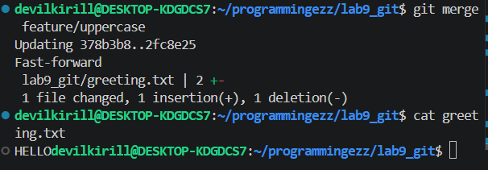

с помощью merge обьединили ветки и вывело hello большими буквами

### Задания 15-17
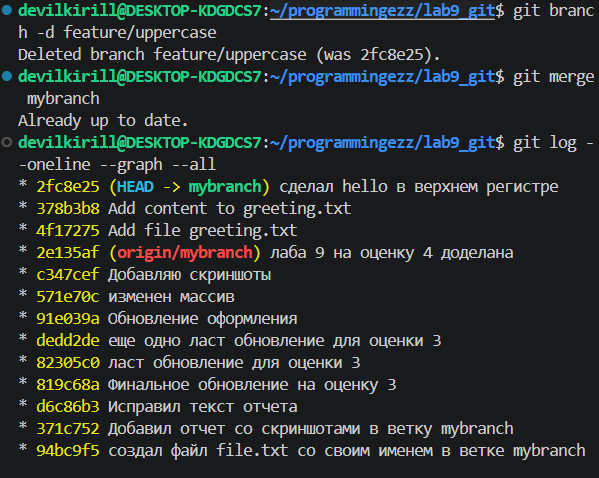

после слияния ветка main взяла себе все коммиты из mybranch

