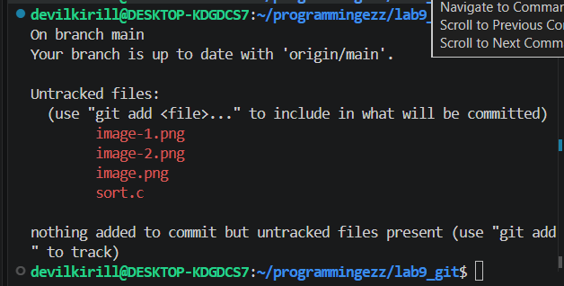
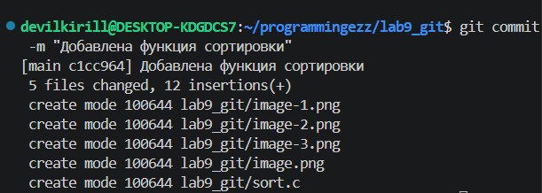
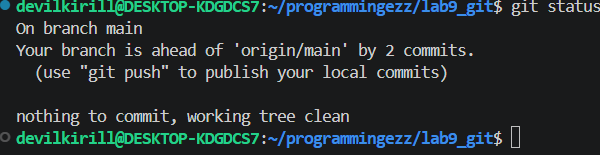
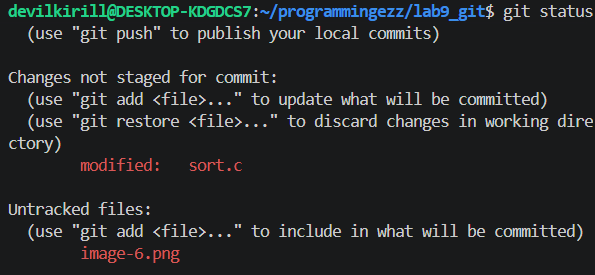
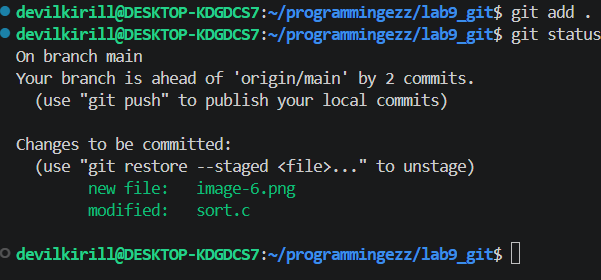
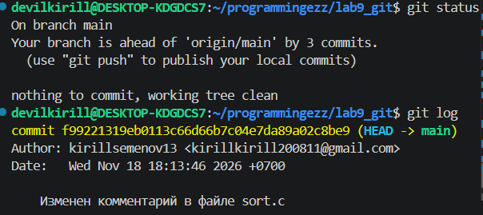
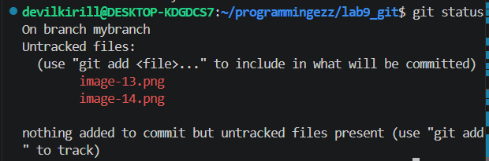
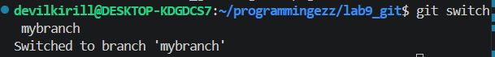
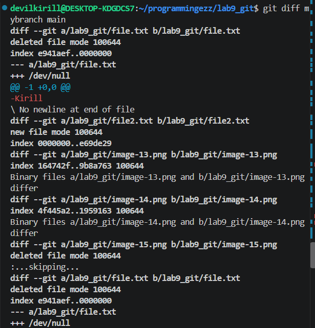

# Лаба 9
# Первый коммит
### 1. Определение ветки

Вывело что нахожусь на ветке main и директория чиста
### 2. Журнал коммитов

Выводит нашу историю создания коммитов
### 3. Создание файла sort.c

Создал файл sort.c и добавил туда функцию сортировки
### 4. Проверка статуса

сейчас он выглядит так
### 5-6. Добавление файла в stage и проверка статуса

после добавления выглядит так
### 7-8. Первый коммит файла

закоммитил файл 

В результате ничего не осталось
### 9-12. Комментирование и добавление add

появился красным цветом, потому что изменили

после добавления стал зеленым, файл перешел в stage
### 13-15. Изменяем файл еще раз и смотрим статус

добавил коммент

закоммитил 

а здесь статус чист, а в логе добавился последний коммит
### 16-17. Добавим в stage, и пушим

добавил и закоммитил, а после запушил

# Ветки
### 1-2. Создаем и смотрим новую ветку

### 3. Переключаемся на новую ветку

переключились
### 4-5. Статус при переключении

видим, что в первой строке появилось "on branch mybranch", строка означает что мы находимся на ветке mybranch, значит мы в этом убедились. 
### 6-8. Создаем файл с именем, коммитим, смотрим что ветка указывает на коммит

создал файл со своим именем, закоммитил, и убедился что ветка указывает на новый коммит
### 9-10. Возврат к main и проверка

мы видим, что коммит с file.txt пропал, потому что он есть только в той ветке mybranch
### 11-12. Новый файл и просмотр что будет

создал новый файл и увидел, что у двух веток разные коммиты!
### 13-15. Идем в mybranch, где file2.txt? Смотрим разницу

как видим, file2.txt пропал, так как он находится только в ветке main

с помощью команды git diff мы увидели, что в ветке main есть file2.txt, а в ветке mybranch есть file.txt
